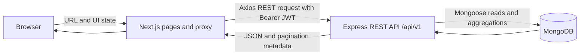
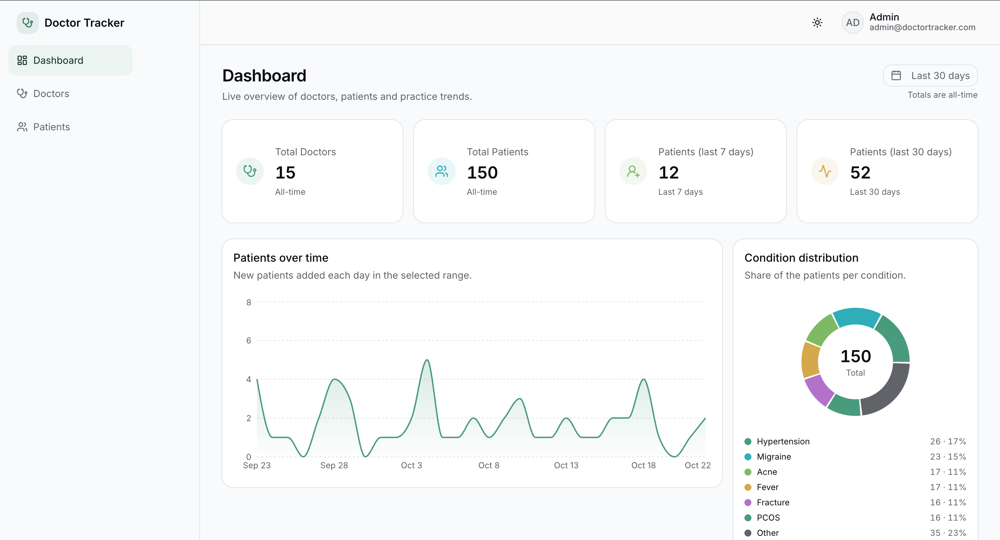
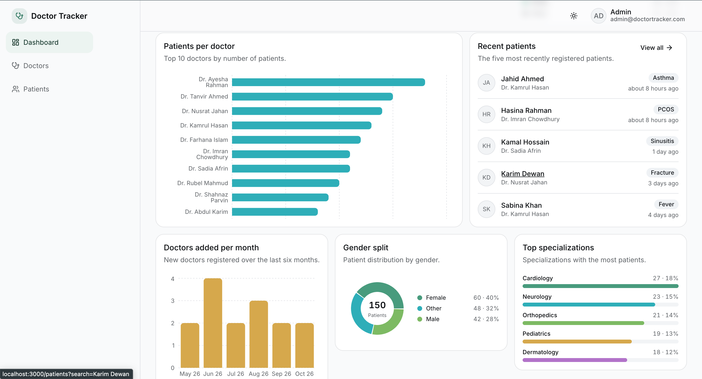
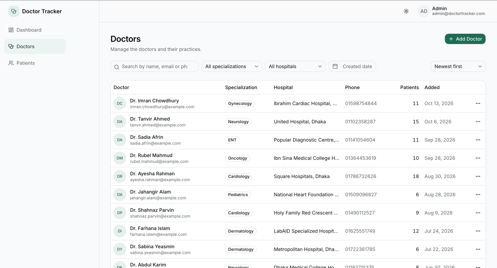
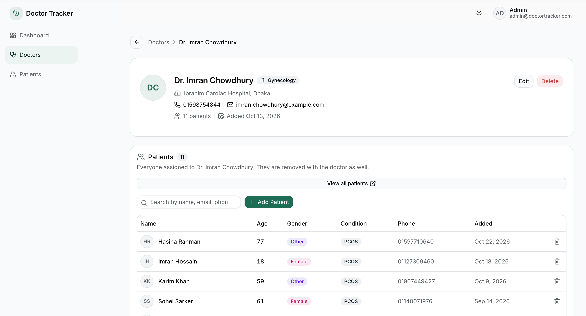
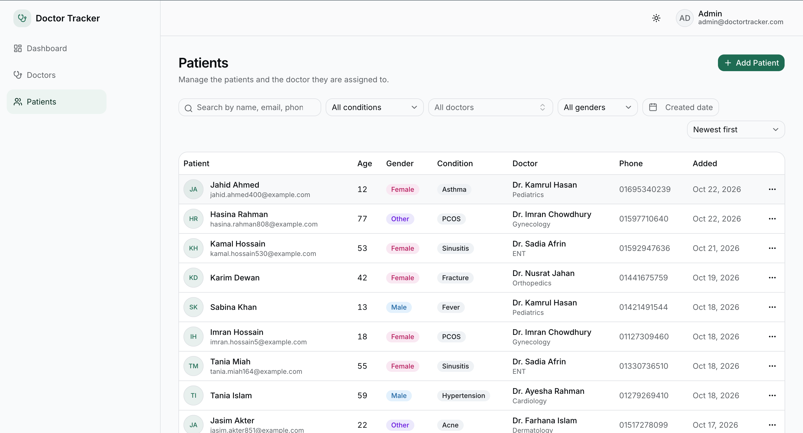
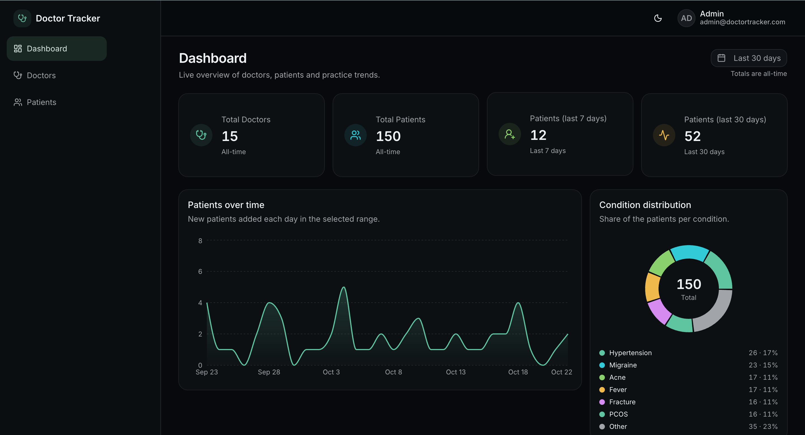
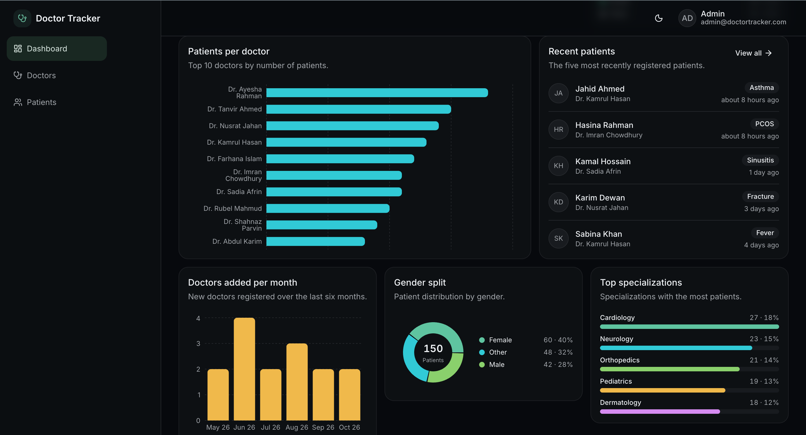
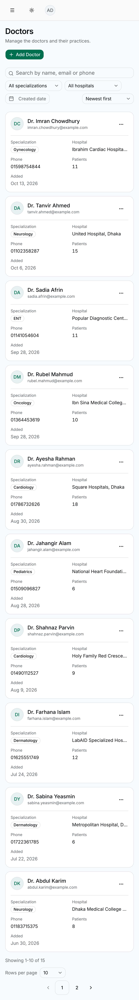

# Doctor Tracker Frontend

## Elevator Pitch

The frontend is a responsive admin portal for reviewing doctors, patients, and dashboard summaries. It is built with the Next.js App Router and consumes the separately deployed Express API over REST.

**Live demo**

- Frontend: `<LIVE_FRONTEND_URL>`
- Backend API: `<LIVE_BACKEND_URL>`
- [Backend repository](https://github.com/HafijurRahmanBhuiyan/doctor-tracker-backend)
- [Root Compose repository](https://github.com/HafijurRahmanBhuiyan/doctor-tracker)

## Setup Guide

### A. Docker

From the root repository, with the backend and frontend checkouts beside the root Compose file, run:

```bash
docker compose up --build
```

This starts MongoDB, the backend, and the frontend. Open `http://localhost:3000`; the API is published at `http://localhost:5001/api/v1`. Root defaults are documented in the root [`.env.example`](../.env.example). This repository also has a frontend-only Compose file; run `docker compose up --build` here when a backend is already reachable at `localhost:5001`.

### B. Manual

Prerequisites: Node.js 22 (the version used by this frontend's Dockerfile), npm, and a running backend API. For the complete local stack, use MongoDB 7. If MongoDB is not already running, start it in a separate terminal:

```bash
mkdir -p /tmp/doctor-tracker-mongo
mongod --dbpath /tmp/doctor-tracker-mongo --bind_ip 127.0.0.1 --port 27017
```

Then follow the [backend manual setup](https://github.com/HafijurRahmanBhuiyan/doctor-tracker-backend#b-manual): copy its `.env.example` to `.env`, set `PORT=5001`, install with `npm ci`, and run `npm run seed` followed by `npm run dev` in separate terminals. `npm run seed` is optional if you instead set `SEED_DEMO_DATA=true` for server startup.

```bash
cp .env.example .env.local
# Confirm NEXT_PUBLIC_API_URL points to the browser-reachable API.
npm ci
npm run dev
```

The app runs on `http://localhost:3000`; set `NEXT_PUBLIC_API_URL=http://localhost:5001/api/v1` when the backend uses the macOS-safe host port 5001. The local default demo login is `admin@doctortracker.com` / `Admin@12345` when the backend is configured with those values. `NEXT_PUBLIC_*` variables are public and baked into production builds; rebuild after changing them.

| Variable | Required | Default in `.env.example` | Description |
| --- | --- | --- | --- |
| `NEXT_PUBLIC_API_URL` | No | `http://localhost:5001/api/v1` | Browser-visible backend API base URL. |
| `NEXT_PUBLIC_SHOW_DEMO_CREDENTIALS` | No | `true` | Controls whether the login view displays demo credentials. |

## System Architecture



The browser renders Next.js pages; the proxy reads the `dt_token` cookie and protects `/dashboard`, `/doctors`, and `/patients`. Login obtains a JWT and the frontend stores it in that cookie. API requests attach it as a Bearer token; the Axios 401 interceptor clears it and navigates to `/login`. The REST API is the only application-data path to MongoDB.

For list pages, query-string state drives the TanStack Query key and REST request. The backend validates the request, applies indexed filters/sorts, and returns the page plus `meta` counts. Dashboard charts consume the backend's aggregate response. Under root Compose, frontend, backend, and MongoDB share a private network; only ports 3000 and 5001 are published, with MongoDB private. See the [root repository](https://github.com/HafijurRahmanBhuiyan/doctor-tracker) for the complete Compose setup and the [backend repository](https://github.com/HafijurRahmanBhuiyan/doctor-tracker-backend) for API source and endpoint contracts.

## Technical Decisions

### 1. Indexed word-prefix search, compound filter/sort indexes, and aggregation-based analytics

- **Problem:** Provide useful search and date/filter workflows without making list requests rely on unindexed substring scans, and keep the dashboard aggregation manageable as records grow.
- **Options considered:** Case-insensitive substring regex; MongoDB text search; normalized precomputed tokens with anchored prefixes; and joining every patient row versus grouping by doctor before lookup.
- **Decision:** The backend stores searchable words in `searchTokens`, queries case-insensitive anchored word prefixes, and ANDs multiple query words. Search intentionally does not match the middle of a word. Doctor indexes are `email_1` (unique), `createdAt_-1`, `name_1`, `searchTokens_1_createdAt_-1`, `specialization_1_createdAt_-1`, and `hospital_1_createdAt_-1`; patient indexes are `doctor_1_createdAt_-1`, `gender_1_createdAt_-1`, `createdAt_-1`, `name_1`, `searchTokens_1_createdAt_-1`, `age_1`, `condition_1_createdAt_-1`, and `doctor_1_searchTokens_1_createdAt_-1`. The dashboard groups patient counts by doctor before joining specialization. Date-only bounds use Asia/Dhaka days and page size is capped at 50.
- **Trade-offs:** Mid-word substring search is deliberately unavailable because it cannot use these prefix indexes. Search tokens must be updated on writes and backfilled. Compound indexes improve supported query shapes at the cost of index storage and write overhead.
- **Evidence:** On a separate performance database with 500 doctors and 30,000 patients, the recorded `explain("executionStats")` run covered 30 query shapes with zero flagged; every list query used IXSCAN and took 0–7 ms. Common prefixes `a`, `m`, `s`, and `me` examined at most 145 documents and took 0–1 ms. The specialization aggregation changed from 375 ms joining per patient across 30,000 rows to 17 ms after grouping to 500 doctors first. Backend reproduction scripts are `scripts/perf-seed.mjs` and `scripts/explain-report.mjs` in the [backend repository](https://github.com/HafijurRahmanBhuiyan/doctor-tracker-backend).

### 2. URL state for list views and TanStack Query for server state

- **Problem:** Users need URLs that preserve search, filters, sort, page, and page size, while server responses need caching and refresh behavior.
- **Options considered:** Store list controls and API data in Redux or Context, or keep navigation state in the URL and server responses in TanStack Query.
- **Decision:** The `useUrlState` hook makes the query string the source of truth; filter changes reset page to one. Debounced search writes URL state after typing settles. Query keys include the request params and list hooks use `keepPreviousData`. Mutations invalidate affected lists, details, dashboard stats, and filter options. Doctor detail patient add/remove has optimistic updates with rollback. Patient create/update/delete currently relies on invalidation and server responses rather than optimistic patient-list updates.
- **Trade-offs:** URL parsing/default handling adds complexity, and components reading search params need the proper Suspense boundary. Hydration-safe rendering needs care. Keeping API data in TanStack Query avoids a duplicate global client store, while invalidation can cause a refetch after writes.
- **Evidence:** See `src/hooks/use-url-state.ts`, `src/lib/query-keys.ts`, `src/hooks/use-doctors.ts`, and `src/hooks/use-patients.ts`. Patient mutations invalidate patient lists/details/options, dashboard stats, doctor lists/details, and doctor-patient queries. Patient list reads retain prior page data while the next query loads.

**Other notable decisions**

- JWT is held in the `dt_token` cookie for Next proxy protection and sent as a Bearer header to support separately hosted frontend and API origins.
- Zod schemas validate frontend forms as well as backend request bodies.
- A shared backend date helper gives date-only filters consistent Asia/Dhaka day boundaries.
- Configurable IP-based rate limits protect API routes, with a separate login cap.
- Next.js standalone output allows the frontend Docker image to run the packaged `server.js` process.

## Visual Evidence

### Desktop


*Login (desktop).*


*Dashboard (top).*


*Dashboard (lower charts).*


*Doctors list (desktop).*


*Doctor detail (desktop).*


*Patients list (desktop).*


*Dashboard dark mode (top).*


*Dashboard dark mode (lower charts).*

### Mobile


*Dashboard (mobile).*


*Doctors list (mobile).*


*Patients list (mobile).*

## Features

- Protected admin dashboard with date-aware trends and distribution charts.
- Searchable, filterable doctor and patient lists with URL-restored state.
- Doctor detail views with patient management and patient counts.
- Responsive table/card layouts, dark mode, pagination, and form dialogs.

## Tech Stack

Next.js 16.4.2, React 19.3.0, TypeScript, Tailwind CSS 4, TanStack Query 5, React Hook Form, Zod 4, Recharts 3, Axios, and Sonner. Versions are taken from `package.json`.

## Deployment

Deploy the frontend on Vercel and the API separately (the backend setup is in its [repository README](https://github.com/HafijurRahmanBhuiyan/doctor-tracker-backend)). Set `NEXT_PUBLIC_API_URL` to the public backend URL ending in `/api/v1` and `NEXT_PUBLIC_SHOW_DEMO_CREDENTIALS` to `true` or `false`. Both are public build-time values and require a new build after changes. Configure backend `CLIENT_URL` to include the deployed frontend origin; it accepts a comma-separated list of valid URLs. Use MongoDB Atlas through backend `MONGO_URI`, and set a strong `JWT_SECRET` plus admin credentials. Backend build/start commands are `npm run build` and `npm start`. Render's free tier can have cold starts after inactivity.

## Project Structure

```text
src/app/          App Router pages, route layouts, loading and error states
src/components/   Shared UI and feature-specific components
src/hooks/        URL state and TanStack Query hooks
src/lib/          API client, query keys, validation, and helpers
src/services/     Typed REST service functions
src/types/        API and view model types
```

## Troubleshooting

- **Port 5000 / AirPlay:** On macOS use the backend on port 5001; its API URL is `http://localhost:5001/api/v1`.
- **CORS errors:** Add the exact frontend origin to backend `CLIENT_URL`; separate allowed URLs with commas.
- **Changed `NEXT_PUBLIC_*` setting is ignored:** public variables are baked into the production build; rebuild/redeploy.
- **HTTP 429:** the backend applies an IP-based general limit and a stricter login limit; check its `RATE_LIMIT_*` variables.
- **Slow initial request on Render:** the free tier may need to wake from sleep, so its first request can incur a cold start.

